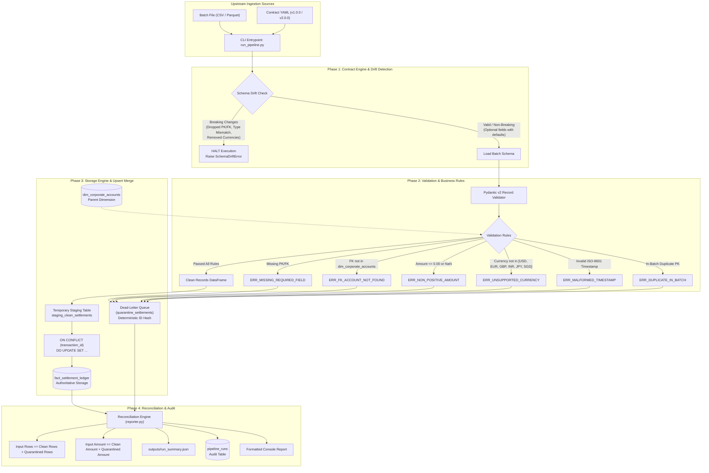

# YottaFlex AI Technologies — Data Contract & Ingestion Engine
### 72-Hour Data Engineering Take-Home Challenge | AI Data Forward Deployed Engineer (AI FDE)

[](https://www.python.org/downloads/)
[](https://duckdb.org/)
[](https://docs.pydantic.dev/)
[](https://pytest.org/)
[](#idempotency-guarantees)

---

## 1. Executive Summary & Domain Context

In enterprise financial technology, clean transactional data is the foundational lifeblood for predictive AI systems. At **YottaFlex AI Technologies**, the **Multi-Currency Transaction & Settlement Ledger** (`fact_settlement_ledger`) feeds business-critical downstream consumers:
- **B2B Credit & Counterparty Financial Risk Models**
- **Autonomous Multi-Currency Liquidity & Treasury Forecasting**
- **Real-Time Cross-Border Fraud & AML Detection AI**

If corrupted currencies, negative settlement amounts, malformed timestamps, unvalidated foreign keys, or unannounced breaking schema drifts reach analytical storage, downstream AI models suffer catastrophic inference degradation, inaccurate capital allocation, or false regulatory reporting.

This production-grade Data Contract & Ingestion Engine enforces strict schema contracts upstream, prevents silent data corruption, routes anomalies to a queryable **Dead-Letter Queue (DLQ)** with full payload fidelity, guarantees **storage-level idempotency**, and provides **closed-loop mathematical reconciliation**.

---

## 2. End-to-End Architectural Architecture Flow



---

## 3. Data Dictionary

### 3.1. Parent Dimension: `dim_corporate_accounts`
The dimension table modeling pre-registered enterprise counterparties and corporate credit accounts.

| Column | Type | Constraints | Description |
| :--- | :--- | :--- | :--- |
| `account_id` | `VARCHAR` | `PRIMARY KEY` | Unique enterprise account identifier (e.g., `'CORP_1001'`). |
| `company_name` | `VARCHAR` | `NOT NULL` | Registered legal corporate entity name. |
| `country_code` | `VARCHAR` | `NOT NULL` | 2-letter ISO-3166 country code (`'US'`, `'DE'`, `'IN'`, `'GB'`, `'SG'`, `'JP'`, `'SE'`). |
| `base_currency` | `VARCHAR` | `NOT NULL` | Corporate operating base currency (`'USD'`, `'EUR'`, `'INR'`, `'GBP'`, `'SGD'`, `'JPY'`). |
| `account_status` | `VARCHAR` | `NOT NULL` | Account lifecycle state (`'ACTIVE'`, `'SUSPENDED'`, `'CLOSED'`). |
| `credit_limit` | `DOUBLE` | `NOT NULL` | Maximum authorized credit threshold in base currency. |

### 3.2. Fact Table: `fact_settlement_ledger`
The authoritative analytical storage table consumed directly by downstream financial risk, liquidity forecasting, and fraud AI models.

| Column | Type | Constraints | Description |
| :--- | :--- | :--- | :--- |
| `transaction_id` | `VARCHAR` | `PRIMARY KEY` | Unique deterministic settlement transaction identifier (e.g., `'TXN_90001'`). |
| `account_id` | `VARCHAR` | `FOREIGN KEY` | References `dim_corporate_accounts.account_id`. |
| `settlement_amount`| `DOUBLE` | `NOT NULL, > 0.00` | Monetary settlement volume, rounded to 2 decimal places. |
| `currency` | `VARCHAR` | `NOT NULL` | Permitted 3-letter ISO-4217 code: `['USD', 'EUR', 'GBP', 'INR', 'JPY', 'SGD']`. |
| `settlement_type` | `VARCHAR` | `NOT NULL` | Business category: `['INVOICE_SETTLEMENT', 'TREASURY_TRANSFER', 'MERCHANT_PAYOUT', 'REFUND']`. |
| `status` | `VARCHAR` | `NOT NULL` | Settlement state: `['COMPLETED', 'PENDING', 'FLAGGED']`. |
| `event_timestamp` | `TIMESTAMP` | `NOT NULL` | UTC transaction event timestamp in ISO-8601 format. |
| `ingested_at` | `TIMESTAMP` | `NOT NULL` | System ingestion timestamp. |
| `source_file` | `VARCHAR` | `NOT NULL` | Name of the source batch file providing lineage. |
| `fx_rate` | `DOUBLE` | `DEFAULT 1.0` | Optional foreign exchange rate relative to USD (v2+). |
| `counterparty_lei`| `VARCHAR` | `NULLABLE` | Optional 20-character ISO-17442 Legal Entity Identifier (v2+). |

### 3.3. Dead-Letter Queue: `quarantine_settlements`
Isolates anomalous, uncontracted, or corrupted records without losing raw input payloads.

| Column | Type | Constraints | Description |
| :--- | :--- | :--- | :--- |
| `quarantine_id` | `VARCHAR` | `PRIMARY KEY` | Deterministic SHA-256 hash of `(source_file, payload, error_code)` for rerun idempotency. |
| `raw_payload_json`| `VARCHAR` | `NOT NULL` | Full raw unadulterated payload serialized as JSON. |
| `error_code` | `VARCHAR` | `NOT NULL` | Explicit error categorization code (see Edge Case Matrix). |
| `error_message` | `VARCHAR` | `NOT NULL` | Descriptive human-readable diagnostic message. |
| `source_file` | `VARCHAR` | `NOT NULL` | Origin batch filename for provenance. |
| `quarantined_at` | `TIMESTAMP` | `NOT NULL` | Timestamp when record was routed to quarantine. |

### 3.4. Pipeline Audit Log: `pipeline_runs`
Maintains execution lineage, throughput metrics, and contract versions for every run.

| Column | Type | Description |
| :--- | :--- | :--- |
| `run_id` | `VARCHAR PRIMARY KEY` | Unique execution run identifier (e.g., `'RUN_0EDB74110C3E'`). |
| `batch_file` | `VARCHAR` | Name of the processed input batch file. |
| `contract_version`| `VARCHAR` | Semantic version of the governing contract (e.g., `'1.0.0'`). |
| `status` | `VARCHAR` | Operational status (`'SUCCESS'`, `'PARTIAL_SUCCESS_WITH_QUARANTINE'`, `'SUCCESS_EMPTY_BATCH'`). |
| `input_rows` | `BIGINT` | Total records ingested from the batch. |
| `clean_rows` | `BIGINT` | Total records successfully upserted into the ledger. |
| `quarantined_rows`| `BIGINT` | Total records routed to the DLQ. |
| `execution_time_seconds` | `DOUBLE` | End-to-end execution runtime in seconds. |
| `started_at` | `TIMESTAMP` | Execution start timestamp (UTC). |
| `completed_at` | `TIMESTAMP` | Execution completion timestamp (UTC). |

---

## 4. Edge Case Matrix & Business Rules

The engine handles negative scenarios, corrupt payloads, and data producer drift deterministically:

| Anomaly Scenario | Trigger Condition | Assigned Error Code | Routing Destination | Downstream AI Impact Avoided |
| :--- | :--- | :--- | :--- | :--- |
| **Missing Primary Key** | `transaction_id` is `None`, `""`, or whitespace | `ERR_MISSING_REQUIRED_FIELD` | `quarantine_settlements` | Prevents unindexed ghost records and join corruption in feature store. |
| **Foreign Key Violation** | `account_id` not found in `dim_corporate_accounts` (e.g. `'CORP_9999'`) | `ERR_FK_ACCOUNT_NOT_FOUND` | `quarantine_settlements` | Prevents credit risk models from aggregating exposure against non-existent corporate entities. |
| **Negative Amount** | `settlement_amount < 0.00` (e.g. `-$1,250.50`) | `ERR_NON_POSITIVE_AMOUNT` | `quarantine_settlements` | Prevents false negative liquidity balance projections in treasury forecasting models. |
| **Zero Amount** | `settlement_amount == 0.00` | `ERR_NON_POSITIVE_AMOUNT` | `quarantine_settlements` | Eliminates zero-dollar spam that distorts average ticket size metrics in fraud algorithms. |
| **Unsupported Currency** | Currency not in `['USD', 'EUR', 'GBP', 'INR', 'JPY', 'SGD']` (e.g. `'BITCOIN'`, `'XYZ'`) | `ERR_UNSUPPORTED_CURRENCY` | `quarantine_settlements` | Prevents currency mismatch calculation crashes in cross-border risk pricing models. |
| **Malformed Timestamp** | Non-ISO-8601 string (e.g. `'2026-13-45T99:99:99'`) | `ERR_MALFORMED_TIMESTAMP` | `quarantine_settlements` | Prevents temporal sequence breakages in time-series forecasting models (e.g. ARIMA / LSTM). |
| **In-Batch Duplicate PK** | Same `transaction_id` appears $\ge 2$ times within the same input batch file | `ERR_DUPLICATE_IN_BATCH` | First instance loads; duplicates route to `quarantine_settlements` | Prevents ambiguous duplicate writes and double-counting in batch transactions. |
| **Empty Input File** | Batch file has 0 bytes or 0 rows | Handled gracefully | Logged to `pipeline_runs` as `SUCCESS_EMPTY_BATCH` | Eliminates pipeline crashes and unhandled exceptions during off-peak zero-volume periods. |
| **Breaking Schema Drift** | Dropped required columns, type conversion (`float -> string`), or removed allowed values | `SchemaDriftError` | **Pipeline Execution Aborted** | Prevents breaking database schema migrations and schema mismatch errors in downstream pipelines. |
| **Non-Breaking Schema Drift** | New optional columns with defaults (e.g. `fx_rate`, `counterparty_lei`) | Accepted seamlessly | Loaded to `fact_settlement_ledger` | Allows seamless contract evolution without producer-consumer synchronization lockstep. |

---

## 5. Idempotency Guarantees

Idempotency is mathematically and architecturally guaranteed at every layer:

1. **Analytical Fact Storage (`fact_settlement_ledger`)**:
   - Clean rows are staged into `staging_clean_settlements`.
   - Ingested via atomic `ON CONFLICT (transaction_id) DO UPDATE SET ...` (or `INSERT OR REPLACE`).
   - If an identical batch is re-run $N$ times, `SELECT COUNT(*)` and `SELECT SUM(settlement_amount)` remain strictly invariant ($O(1)$ mutation).
   - If updated transaction attributes arrive under an existing `transaction_id`, the row is updated in-place without duplicating records.

2. **Dead-Letter Queue (`quarantine_settlements`)**:
   - Every quarantine record derives a deterministic `quarantine_id`:
     $$\text{quarantine\_id} = \text{SHA256}(\text{source\_file} \mathbin{\Vert} \text{raw\_payload\_json} \mathbin{\Vert} \text{error\_code})_{[:16]}$$
   - Inserted using `INSERT OR REPLACE INTO quarantine_settlements`.
   - Rerunning an identical batch never inflates DLQ record counts.

---

## 6. Quickstart & Installation

### 6.1. Prerequisites
- Python 3.10+ (tested on Python 3.12.3)
- Windows 11 / Linux / macOS (100% cross-platform paths using `pathlib.Path`)

### 6.2. Installation
Clone the repository and install dependencies:
```bash
# Install core dependencies
pip install -r requirements.txt
```

Verify installed packages:
```bash
python -c "import duckdb, pydantic, yaml, pandas, pyarrow, pytest; print('Environment Ready!')"
```

---

## 7. CLI Usage & Verification Commands

The engine provides a unified CLI entrypoint: `run_pipeline.py`.

### 7.1. Run Starter Batch (25 Rows with Intentional Anomalies)
Generates the deterministic starter batch (`seed=42`) and ingests it against the baseline contract:
```bash
python run_pipeline.py --generate --rows 25 --batch data/starter_batch.csv --report
```
**Expected Output:**
- Total Input Rows: `25`
- Clean Rows Loaded: `13`
- Quarantined Rows (DLQ): `12`
- Discrepancy: `0` (`[✓ PASSED] BALANCED`)
- Monetary Discrepancy: `$0.00` (`[✓ PASSED] BALANCED`)

### 7.2. Test Non-Breaking Contract Evolution (v2 Valid)
Ingests the batch against the evolutionary contract containing optional `fx_rate` and `counterparty_lei` columns:
```bash
python run_pipeline.py --batch data/starter_batch.csv --contract contracts/settlements_contract_v2_valid.yaml --baseline-contract contracts/settlements_contract_v1.yaml
```
**Expected Output:**
- Pipeline accepts the evolutionary schema without errors.
- Schema drift summary logs `NEW_OPTIONAL_FIELD` additions.
- Exit code: `0`.

### 7.3. Test Breaking Contract Evolution (v2 Breaking)
Demonstrates immediate execution abort and safeguard against breaking schema changes (dropped `account_id`, string amount, removed currencies):
```bash
python run_pipeline.py --batch data/starter_batch.csv --contract contracts/settlements_contract_v2_breaking.yaml --baseline-contract contracts/settlements_contract_v1.yaml
```
**Expected Output:**
- `CRITICAL SCHEMA DRIFT VIOLATION DETECTED` audit banner displayed.
- Detailed diff classifies `DROPPED_REQUIRED_FIELD`, `INCOMPATIBLE_TYPE_CONVERSION`, and `REMOVED_ALLOWED_VALUES`.
- Pipeline cleanly aborts execution.
- Exit code: `1`.

### 7.4. Run High-Throughput Performance Benchmark (100,000+ Rows)
Generates and benchmarks ingestion of 100,000 synthetic records:
```bash
python run_pipeline.py --benchmark --rows 100000 --report
```
**Performance Metric:**
- Data Generation: **~0.54 seconds** (~185,000 rows/second).
- End-to-End Validation, Foreign Key Checking, DLQ Routing & DuckDB Persistence: **~2.86 seconds** (~35,000 rows/second).
- Financial & Row Reconciliation: **100% Balanced ($0.00 discrepancy)**.

---

## 8. Automated Test Suite (`pytest`)

Execute the complete automated test suite covering all contract checks, edge cases, negative scenarios, and idempotency guarantees:

```bash
# Run all tests with verbose output
python -m pytest tests/ -v
```

### Test Coverage Breakdown:
1. `tests/test_contracts.py`:
   - `test_baseline_contract_loading`: Validates YAML parsing and Pydantic v2 model attributes.
   - `test_non_breaking_contract_evolution`: Validates optional field additions with defaults.
   - `test_breaking_contract_evolution`: Validates dropped FK, type conversion, and currency removal classification.
   - `test_batch_schema_drift_missing_required_column`: Asserts missing columns are caught before row processing.
   - `test_batch_schema_drift_extra_uncontracted_column`: Asserts tolerance of uncontracted producer columns.
   - `test_pipeline_aborts_on_breaking_schema_drift`: Asserts `SchemaDriftError` aborts the pipeline.
2. `tests/test_pipeline.py`:
   - `test_happy_path_ingestion`: Verifies 100% clean ingestion for valid transactions.
   - `test_quarantine_null_primary_key`: Verifies missing `transaction_id` routes to DLQ.
   - `test_quarantine_negative_and_zero_amount`: Verifies amount $\le 0.00$ routes to DLQ.
   - `test_quarantine_unsupported_currency`: Verifies unsupported currencies (`'BITCOIN'`, `'XYZ'`) route to DLQ.
   - `test_quarantine_invalid_foreign_key`: Verifies non-existent accounts (`'CORP_9999'`) route to DLQ.
   - `test_quarantine_malformed_timestamp`: Verifies unparseable ISO timestamps route to DLQ.
   - `test_in_batch_duplicate_primary_key`: Verifies in-batch duplicate deduplication.
   - `test_empty_file_handling`: Verifies 0-byte and 0-row file resilience.
3. `tests/test_idempotency.py`:
   - `test_starter_batch_rerun_idempotency`: Asserts row count and sum of settlement amount are invariant across reruns.
   - `test_in_place_upsert_update`: Asserts in-place update semantics for modified existing transactions.

---

## 9. Performance Optimization Architecture Notes

### Why DuckDB + Pydantic v2 + PyArrow?
1. **Pydantic v2 Core Rust Validation**:
   - Pydantic v2 is implemented in Rust (`pydantic-core`), delivering a 5x–20x performance speedup over v1.
   - Row-level constraint evaluation runs at over 35,000 records/second without sacrificing validation granularity.

2. **DuckDB In-Process Columnar Vectorization**:
   - DuckDB processes data in vectorized chunks of vectors (typically 2048 tuples) residing in L1/L2 CPU caches.
   - DuckDB's native Parquet reader and PyArrow integration allow zero-copy memory transfers between Python data frames and analytical storage.
   - The staging-table merge pattern (`ON CONFLICT (transaction_id) DO UPDATE`) executes as an optimized hash-join inside DuckDB, avoiding sequential row-by-row disk I/O.

3. **Memory Footprint & Scale-to-Millions**:
   - The pipeline operates within minimal memory footprints (< 250 MB RAM for 100k rows) by streaming data and utilizing columnar storage.
   - For multi-gigabyte or multi-million row scale, DuckDB handles out-of-core spill-to-disk execution automatically without memory exhaustion.

